# Installing firmware, provisioning on TheThingsNetwork, and getting data to Google Sheets example
# Firmware Technical Documentation - Installation and setup
## The Things Network: Applications and Devices

The Things Network (TTN), sometimes called The Things Stack (TTS), is a cloud based LoRaWAN managing service with a free membership type. We use it to manage the Gateways and devices (sensors). You will need the following: 
- An account on The Things Network TTN ([here](https://accounts.thethingsindustries.com/signup?from=%2Fcheckout%3Fp%3DTTS-CLOUD_DISCOVERY_23Q2_MONTHLY_USD/))
- A functioning `TTN LoRa Gateway` in range of your device ([here](https://www.thethingsnetwork.org/docs/gateways/))

### Starting on TTN: Make an Application
An `Application` on TTN is a grouping of devices that can be of different kinds. To start:
- Login [here](https://nam1.cloud.thethings.network/console/) with your TTN credentials.
- Goto Application-> Add application.

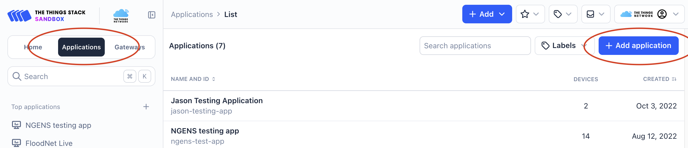

- Enter Application ID (e.g. `ngens-test-app`) and Application Name (e.g. `NGENS testing app`). Go to the new Application. NOTE: This is a permanent feature of the `Application` so choose a good, long term name.

### Adding a new end-device in the Application
- In the new Application goto `End Devices` then `+ Register end device`.

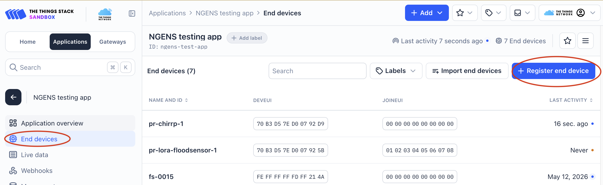

- Enter `Heltec` in the `End device brand` window and `HelTec AutoMation` should pop up. See image below.


- Select or Enter as in image above: 
  - `Model -> HTCC-AB02 (Class A OTAA)`
  - `Hardware Ver. -> Unknown`
  - `Firmware Ver. -> 1.0`
  - `Profile (Region) -> US_902_928`
  - `Frequency Plan -> United States 902-928 MHz, FSB 2 (used by TTN)`
- Scroll down to `Provisioning information` (image below) and Enter: 
  - `JoinEUI -> 00 00 00 00 00 00 00 00` and `Confirm`. This will open other fields as in next image.


  - `DevEUI -> Generate`
  - `AppKey -> Generate`
  - `End device ID ->` Enter an ID for the device. Only lower case and dashes. This is a permanent feature of the device. Choose a long-term name.
- Enter `Register end device`. This will take you to the new device page `Device overview`. 
- If you go to `Settings` you can give it a more elaborate name which is editable under `End device name` and `End device description`. You can also set its location. 

## Arduino IDE
The Arduino IDE is used for compiling and uploading the firmware code, with the TTN provisioning information, to the microcontroller.
- Get the Arduino IDE from [Arduino's website](https://www.arduino.cc/en/software). 
- Add Heltec Boards info to the IDE:
1) Using Arduino's Boards Manager:
  - In Arduino IDE goto `File->Preferences->Settings`


  - Open `Additional boards manager URLs:` window and cut and paste this url `https://github.com/HelTecAutomation/CubeCell-Arduino/releases/download/V1.5.0/package_CubeCell_index.json` in a new line of the window. Then ok.
  - Then goto `Tools->Board->Boards Manager`. Search 'CubeCell'. Select the latest releases and click install. It may take a minute.


  2)  Or using Github Follow the instructions mentioned [here.](https://github.com/HelTecAutomation/CubeCell-Arduino/blob/master/InstallGuide/windows.md)

Goto `Tools->Board->CubeCell Development Framework->CubeCell-Boare Plus (HTCC-AB02)`. If not visible try restarting Arduino IDE.

## Programming and provisioning the flood sensor device
 If you haven't already, download the `floodnet sensor` files from this [Github repo](https://github.com/floodnet-nyc/flood-sensor/tree/main) (click the green `Code` button -> Download ZIP. This will download the whole repository. Move it to your Arduino folder - optional).

- Start the `Arduino IDE` program and open the file `firmware.ino` in the `firmware` subfolder. You will get the `firmware.ino` file and 10 other files in adjacent tabs.
- Connect the `HelTec CubeCell` board of the device to your computer with a `Micro USB` cable. (A `CP2102` driver is required on your computer. It should install automatically. Refer to this [document](https://docs.heltec.cn/general/establish_serial_connection.html) if you have trouble.)

`NOTE:` If this is a new Heltec board it will probably be flashing its LED colors. If it has been programmed before, make sure you erase its memory as described farther on in this document. (search for EEPROM)

- In the Arduino IDE select `Tools>Board>CubeCell Development Framework>CubeCell-Board Plus (HTCC-AB02)`. Set the `LORAWAN_*` configurations `EXACTLY` as shown in image below.


- Select the `Tools>Port` where the `CubeCell` is connected. It may take some sleuthing to figure out which `Port` it is. The easiest way is to disconnect the board and see which `Port` disappears.

### Provisioning the device (device secrets)
`NOTE`: The device memory (EEPROM) should be cleared if the device has been previously configured. To clear the memory, open `File->Examples->EEPROM->eeprom_clear`, compile the code and upload to the device by clicking on the right arrow symbol at top left of Arduino IDE. This will clear the memory. When finished close the `eeprom_clear` Arduino window.

#### Adding device secrets to the code.
- With `firmware.ino` open, all the files required by the sensor will open in adjacent tabs.
- Go to the `device_secrets.h` tab. If you are doing this for the first time the secrets should be empty as in the following image:

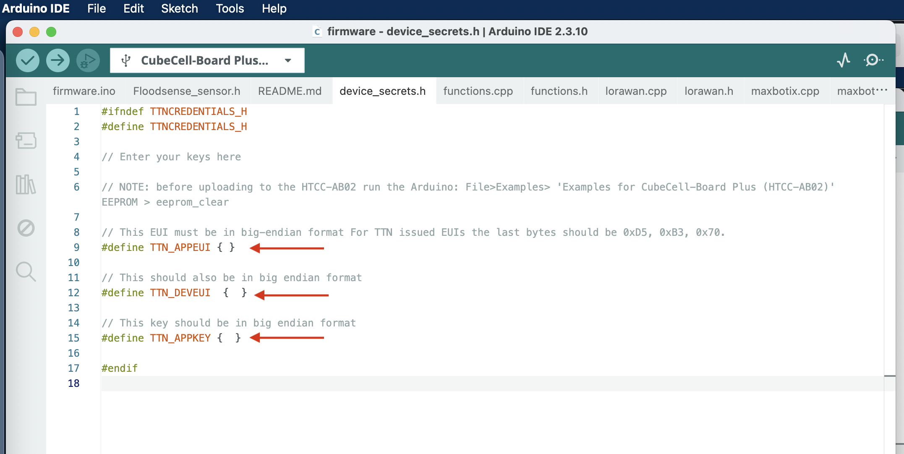

- From `The Things Stack>Applications>Your Application>End devices>Your new device` locate and go to `Activation information` where you will find `AppEUI, DevEUI, AppKey`. We need to copy/paste these values into our Arduino `device_secrets.h` file. There is a copy icon if you hover your mouse over the field. Before copying, make sure the numbers are comma separated by toggling the `</>` icon. Make sure the `msb` icon is showing. See following image:

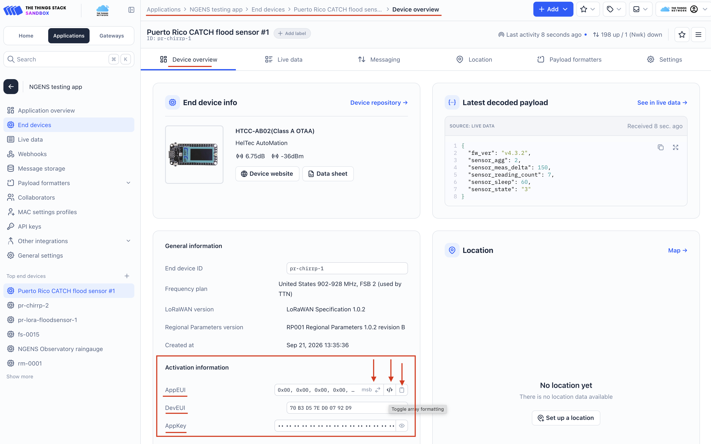

- Cut/paste `DevEUI, AppEUI, AppKey` to `TTN_DEVEUI`, `TTN_APPEUI` and `TTN_APPKEY` in the `device_secrets.h` Arduino file, as shown in the image below.

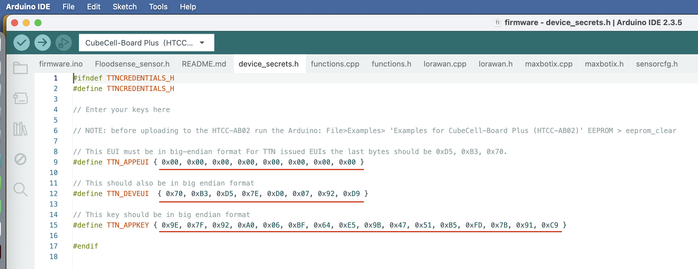

- Save the file.

## Compiling and Uploading the firmware to the sensor
- Make sure your `Heltec CubeCell` board is connected and the communication Port is selected.
- Compile the code by clicking on the `Check Mark` in the upper left corner of the Arduino IDE. If it compiles without errors, upload it with the `Right Arrow` icon in the IDE.
- Check the `CubeCell` by opening the `Serial Monitor` in the IDE - it is the `spyglass` icon in the top right. A sub window will appear at the bottom of the IDE. 
- Set the `baud` to `115200` in the top right of the `Serial Monitor` window of the IDE
- To verify your `DevEUI`, `AppEUI` and `AppKey`, reset the `CubeCell` with its side microbutton labled `RST`. The `Serial Monitor` window will display the values as in this image:

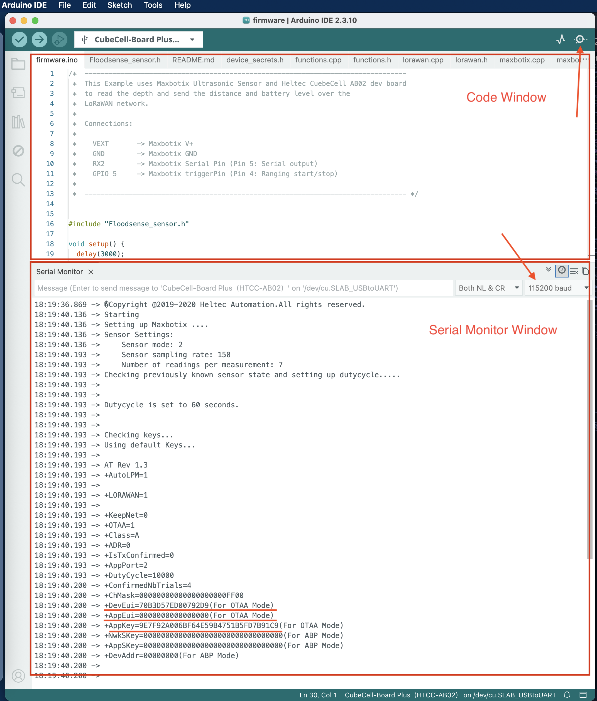 

- At this point, if all is going well, you should see the Joining protocol of the device to TTN, and then the `data uplinks` from the device will show up on the `live data`, as shown in image below:

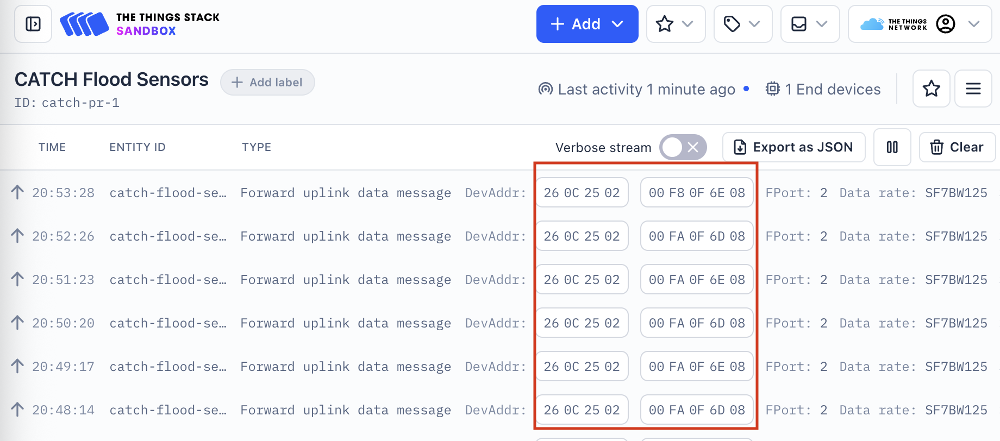 

- You can see the `DevAddr` field followed by the 5 bytes of payload/data. If you click on the message you will see the all the data fields in a `JSON` object.

## Getting the Data Packages on TTN 
The device page can run code to translate (or decode) the data bytes from the device into a legible format.
- From `The Things Stack: Applications>[your application]>Payload formatters>Uplink` locate and go to the `Formatter type` pulldown and select `Custom Javascript formatter`.


- Copy and Paste the script below, replacing the default `Formatter code` in the window. Save changes.

#### TTN Decoder (Java Script)
```
function Decoder(b, port) {
  var decoded = {};

// Error Flags
/*
Format:
-----------------------Error Flags------------------------------|
| bit 7 | bit 6 | bit 5 | bit 4 | bit 3 | bit 2 | bit 1 | bit 0 |
|     Used only for CFG update (all other bits are high)       |             |              |              |              |              |              | SD error flag|
255 or FF is a CFG update
*/
  
  var errorFlag = b[0];

  if (errorFlag == 255) {

// Payload is Sensor cfg update    
/*
CFG update uplink Format:
| Error Flag  |   sensor_sleep   |    sensor_agg     |   sensor_meas_delta     | sensor_reading_count   |    sensor_state   |    fw_ver       |
|    255 (FF) |     2 bytes      |      1 byte       |          2 bytes        |          1 byte        |        1 byte     |    6 bytes      |
                
Sensor State:
|  Start  |   Stop  |  Reset  |
|   's'   |   'x'   |   'r'   |
*/

    // Duty cycle
    var sensor_sleep = (b[2]<< 8) | b[1];
    decoded.sensor_sleep = sensor_sleep;

    // Sensor Mode
    var sensor_agg = b[3];
    decoded.sensor_agg = sensor_agg;

    // Sensor Sampling Rate
    var sensor_meas_delta = (b[5] << 8) | b[4];
    decoded.sensor_meas_delta = sensor_meas_delta;

    // Sensor number of readings per measurement
    var sensor_reading_count = b[6];
    decoded.sensor_reading_count = sensor_reading_count;

    // Sensor State
    var sensor_state = b[7].toString();
    if (sensor_state == "115"){
      sensor_state = "Sensing";
    } else if (sensor_state == "120"){
      sensor_state = "CFG Update";
    } else if (sensor_state == "114"){
      sensor_state = "Reset";
    }
    
    decoded.sensor_state = sensor_state;

    // Firmware Version
    let major = b[8].toString();
    let minor = b[9].toString();
    let patch = b[10].toString();
    let v = "v";
    let dot = ".";
    let fw_ver = v.concat(major,dot,minor,dot,patch);
    decoded.fw_ver = fw_ver;
  } else {
    
    // Regular Payload
    var sdError, battery, distance;
    // Converting Error Flag bits
    sdError = errorFlag % 2;
    decoded.sdError = sdError;
  
    battery = (b[2] << 8) | b[1]; // battery in centi Volts
    battery = battery / 1000; // Convert to Volts
    decoded.battery = battery;
  
    distance = (b[4] << 8) | b[3];
    decoded.distance = distance;
  } 
  return decoded; 
} // end function Decoder()
```

- This formatter will apply to all the devices in this `Aapplication` but you need to tell the device this.  
- Go to `Applications>[your application]>End devices>[your end device]>Payload formatters>Uplink` and select from `Formatter type>Use application payload formatter`. Save changes. 
- If you go to `Applications>[your application]>Application data>Live data` you will see your formatted data like this:


NOTE: The `Payload formatters` can be set at the  `Application` level which applies to all the sensors in the `Application` (what we just did), or at the device level such that each device has its own `Payload formatter`.

At this point the data going from the sensor `device`, through the `Gateway`, to `TTN`'s cloud but isn't being stored anywhere. For that you need to 'pipe' it to some database or other storage location. In this document example, we are going to send it to `Google Sheets` which is an easy and covenient first step, and can easily be shared and plotted etc. The problem with this strategy is that each `Google Sheet` can only hold about 0.5 million entries and will start acting up when there are over 200k lines of data. Also, it now belongs to `Google`. 

# Sending Data to Google Sheets
You will need a `Google account` to create `Google Sheets` and be able to write and `deploy` (run) scripts in `Google script`. 
- Create a `Google Sheet` and name it with your device identifier. 
- In your new `Google Sheet` go to `Extensions>Apps Script` which will open a new window with the `App Script` IDE. This script is in `Javascript` and will be associated with the `Google Sheet` from which it was 'created'. However, this script can be used to write to (and read from) any `Google product` in your account and hence it will warn you repeatedly of this as it can be a security issue.

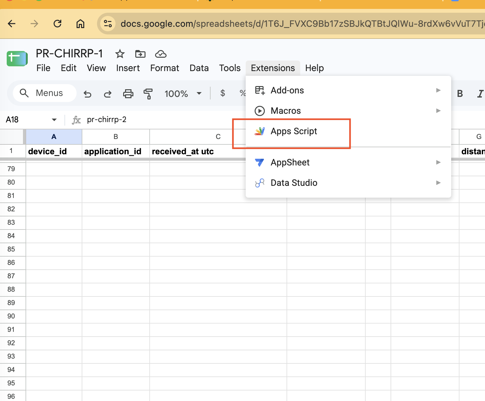

The script page 

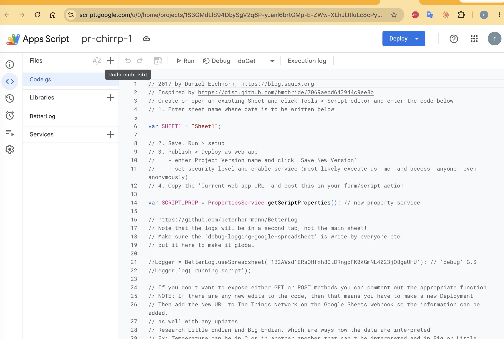

- Copy and paste the script below and follow instructions. 

#### Google Script code
```
// Inspired by https://gist.github.com/bmcbride/7069aebd643944c9ee8b
// 1. Create or open an existing Google Sheet
// 2. Tools > Script editor and enter this code
// 3. Go to end of this script and enter the url of the Google Sheet in function setup() 
// 4. In function setup() enter the LoRa device in SCRIPT_PROP.setProperty("pr-chirrp-2", doc.getId())
// 4. Save. From pulldown select setup and Run once
// 5. Go to Deploy>New Deployment. 
//    - Select type>Web app. 
//    - New description>'1' or whatever. 
//    - Execute as>Me(xx). 
//    - Who has access>Anyone.
// 4. Copy the URL use it in the TheThingsNetwork Webhook
//
// FOR DEBUGGING
// https://github.com/peterherrmann/BetterLog
//  Logger = BetterLog.useSpreadsheet('1B2AWsd1ERaQHfxh8OtDRngoFK0kGmNL4023jO8gaUHU'); 
//  Logger.log('running script');

var SHEET1 = "Sheet1";
var SCRIPT_PROP = PropertiesService.getScriptProperties(); // new property service

function doGet(e){
  return handleResponse(e);
}

function doPost(e){
  return handleResponse(e);
}

function handleResponse(e) { 
  var lock = LockService.getPublicLock();
  lock.waitLock(60000); // wait 30 seconds before conceding defeat.
  
  //Logger = BetterLog.useSpreadsheet('1A69ebTrrdCOTvRgt-FyH8d0Jd42KkeDNpWNZXnKh_Yk'); // 'debug' google sheet 
  
  try { 
    var jsonData = JSON.parse(e.postData.contents);
    var doc = SpreadsheetApp.openById(SCRIPT_PROP.getProperty(jsonData.end_device_ids.device_id)); // see setup() at end
    
    //Logger.log(jsonData.end_device_ids.device_id);
    
    var sheet = doc.getSheetByName(SHEET1);
       
 // we'll assume header is in row 1 but you can override with header_row in GET/POST data
    //var headers = sheet.getRange(1, 1, 1, sheet.getLastColumn()).getValues()[0];
    var nextRow = sheet.getLastRow()+1; // get next row
    var row = [];
    var headerRow = [];
    var d = new Date(); 
    // Time and Date updated to EST 
    dformat = [d.getFullYear(), d.getMonth() + 1, d.getDate()].join(' / ') + ' ' + [d.getHours(), d.getMinutes(), d.getSeconds()].join (' : '); 
    
// loop through the header columns.
// loops through each row to fill each column with its appropriate information 

    headerRow.push("device_id");
    headerRow.push("application_id");
    headerRow.push("received_at utc");
    headerRow.push("local_time"); 
    headerRow.push("f_cnt");

    var dpobj = jsonData.uplink_message.decoded_payload; // decoded payload object
    var dpobj_names = Object.getOwnPropertyNames(dpobj); // get names for decoded payload data, can change depending on device/sensor type
    
    //Logger.log(dpobj_names);
    //Logger.log(dpobj[dpobj_names[0]]);
    
    for (var i=0;i<dpobj_names.length; i++) {
      headerRow.push(dpobj_names[i])
    }
    
    // Gateway info header
    for (var i = 0; i < jsonData.uplink_message.rx_metadata.length; i++) {
      headerRow.push("gtw_id");
      headerRow.push("time");
      headerRow.push("rssi");
      headerRow.push("snr");
    }
    sheet.getRange(1, 1, 1, headerRow.length).setValues([headerRow]); 
    
    // push adds elements to the end of the array 
    row.push(jsonData.end_device_ids.device_id);
    row.push(jsonData.end_device_ids.application_ids.application_id);
    row.push(jsonData.received_at);
    row.push(d); //New Date format /
    row.push(jsonData.uplink_message.f_cnt);

    for (var i=0;i<dpobj_names.length; i++) { // enters the decoded payload values but by alpha order of names 
      row.push(dpobj[dpobj_names[i]]);
    }
 
    for (var i = 0; i < jsonData.uplink_message.rx_metadata.length; i++) {
      var gateway = jsonData.uplink_message.rx_metadata[i];
      row.push(gateway.gateway_ids.gateway_id);
      row.push(gateway.time);
      row.push(gateway.rssi);
      row.push(gateway.snr);
    }

// more efficient to set values as [][] array than individually
    sheet.getRange(nextRow, 1, 1, row.length).setValues([row]);

// return json success results
    return ContentService
    .createTextOutput(JSON.stringify({"result":"success", "row": nextRow}))
    .setMimeType(ContentService.MimeType.JSON);
  } catch(e) {

// if error return this
    return ContentService
    .createTextOutput(JSON.stringify({"result":"error", "error": e}))
    .setMimeType(ContentService.MimeType.JSON);
  } finally { //release lock
    lock.releaseLock();
  }
}

// This alows script to serve out data to multiple google sheets depending on
// the device. It associates the URL of the Google Sheet with the DevID
// In this example the DEVID is 'pr-chirrp-2'
function setup() {  

  SCRIPT_PROP.deleteAllProperties(); // clear properties

  // pr-chirrp-2 PUERTO RICO CHIRRP FS 2
  doc = SpreadsheetApp.openByUrl('https://docs.google.com/spreadsheets/d/1T6J_FVXC9Bb17zSBJkQTBtJQlWu-8rdXw6vVuT7Tjdw/edit');
  SCRIPT_PROP.setProperty("pr-chirrp-2", doc.getId());  

}
```
- Go to end of this script and enter the URL of the Google Sheet in `function setup()` 
- In `function setup()` enter the LoRa device ID in `SCRIPT_PROP.setProperty("pr-chirrp-2", doc.getId())`
- Save. From pulldown select `setup` and Run once
- Go to `Deploy>New Deployment`. 
  - Select type > Web app. 
  - New description > '1' or whatever. 
  - Execute as > Me(xx). 
  - Who has access > Anyone.
  - Deploy

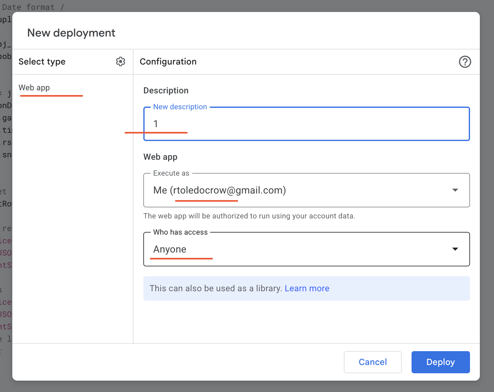

- Copy the URL to use it in the TheThingsNetwork Webhook
- With the `Deploy URL` go back to your `TheThingsNetwork Console>Applications>[your application]>Webhooks>Add> Custom Webhook`
- Webhok ID > enter permanent id name. 
- Webhook format > JSON
- Base URL > Enter the URL from the Deployment in Google Scripts
- Enabled event types > select all
- Add webhook

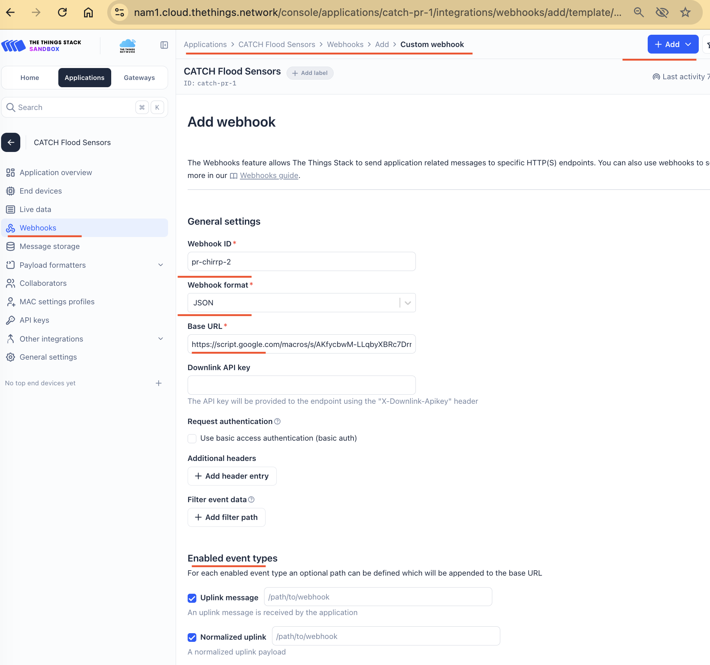

If all goes well, you should start to see the data from the device showing up in the Google Sheet like this:

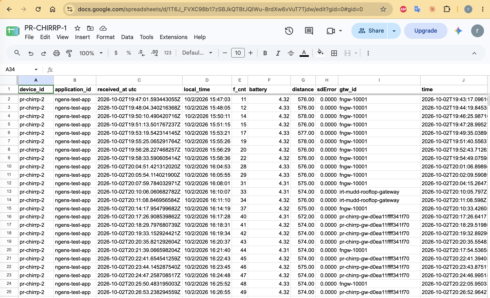

## Controlling the Device
The LoRa devices (Class A like ours) can receive information from TTN. After sending a package of information to TTN (`uplink`), there is a brief window in which the device listens for any messages from TTN (`downlink`). If there is no message it sleeps to save battery.

We can use this mechanism to send commands to the device such as changing its measurement cycle, number of samples to aggregate (median filter), and time between readings in the aggregates. We can also reassign the Application and Device ID on the fly. 

We can also change between three states of the device: `1- Start, 2- Stop, 3- Reset`.
- In `Start state` the device `uplinks` its data package every minute (can be changed)
- In `Stop state` the sensor `uplinks` its current configuration every 10 seconds.
- `Reset state` does a hard reset on the device and put it in either `Start` or `Stop`. 

`NOTE:` There is a switch in the firmware that limits the device to only operate in the `Start` state. See lines 32, 33 of the lorawan.h file (or tab). These #define affect the function downlinDataHandle() in file (or tab) lorawan.cpp line 313.

### Uplink Package Formats: Measurements & Configuration
The device can send or uplink to TTN two types of information packets: the measurement packet and its cofiguration info packet.
### 1- Measurement Packet Format:

When in `Measurement` mode, the format of the `uplinked` measurement packet to TTN is 5 bytes as follows: 

| Error flags  | Battery Level | Ultrasonic reading  |
|--------------|---------------|---------------------|
|   1 byte     |    2 bytes    |        2 bytes      |

### 2- Configuration CFG Packet Format:

| Error flags   | sensor_sleep | sensor_agg | sensor_meas_delta | sensor_reading_count | sensor_state | fw_ver  |
|--------------|--------------|------------|-------------------|----------------------|--------------|---------|
|    0xFF      |     2 bytes  |   1 byte   |     2 bytes       |       1 byte         |   1 byte     | 6 bytes |

### Error flags byte:

| bit 7 | bit 6 | bit 5 | bit 4 | bit 3 | bit 2 | bit 1 | bit 0 |
|-------|-------|-------|-------|-------|-------|-------|-------|
| 1/0   |   1   |  1    |  1    |  1    |  1    |  1    | 1/0   |

Sensor State:
|  Start  |   Stop  |  Reset  |
|---------|---------|---------|
|   's'   |   'x'   |   'r'   |


| Error flags  | Sensor Mode | Sensor Sampling Rate | Sensor Number of Readings |
|--------------|---------------|---------------------|---------------------|
|   1 byte : 255 or 0xFF     |    1 byte   |      2 bytes         |        1 bytes            |


### Downlink packet format

```<header> <command>```

| Header | Command            | Functionality                                                |
| ------ | ------------------ | ------------------------------------------------------------ |
| `0x4D` | Sensor Mode Change | Changes sensor aggregate, duty cycle, measuring delta, number of readings for averaging. |
| `0x41` | Application Change | Changes LoRaWAN Application                                  |
| `0x4F` | Sensor State       | `Start/Stop/Reset`. On a Reset the default sensor state is `Stop`, and it sends CFG packets as uplink. Starts sensing when changed to `Start` state. `Reset` resets the sensor using a watchdog timer. |

### Modifying Sensor Configuration using Downlinks

Following are types of downlinks available categorized based on their functionality.

#### Changing dutycycle

Uplink frequency at the end node is determined by the TX_INTERVAL. This TX_INTERVAL is used as a variable in this library to add the functionality of varying duty cycle. Few examples of changing duty cycle by updating `TX_INTERVAL` are mentioned below:

| Command| Explanation|
|---|---|
| `00 3C`| duty cycle = 60 seconds and 2 bytes are used for the downlink|
| `3C` |duty cycle = 60 seconds and lowest payload size |
| `01 68`| duty cycle = 360 seconds and 2 bytes are used for the downlink|
|`00 3C 00 00 00 00` | Only duty cycle is changed and rest are unchanged. 6 bytes used for the downlink |


#### Changing sensor mode
The sensor mode can be changed by adding non-zero values to the sensor mode byte in the downlink packet. Any invalid modes entered are discarded. Examples:

| Command | Explanation|
|---|---|
| `00 00 01` | changing sensor mode to 1. Consumes 3 bytes: minimal mode change|
| `00 00 01 00 00 00` |changing sensor mode to 1 and the rest are unchanged. Consumes 6 bytes |
| `00 00 06 00 00 00` |Discarded and no change since 6 is an invalid mode. Consumes 6 bytes |
| `01`| Valid packet format but doesn't change sensor mode, instead duty cycle is changed to 1 sec|

#### Changing sampling rate
The sensor sampling rate can be changed by adding non-zero values to the corresponding bytes in the downlink packet. Examples:

| Command | Explanation|
|---|---|
| `00 00 00 00 FA` | changing sensor sampling rate to 250ms. Consumes 5 bytes: minimal sampling rate change|
| `00 00 00 04 E2 00` |changing sensor sampling rate to 1250ms and the rest are unchanged. Consumes 6 bytes |
| `04 E2`| Valid packet format but doesn't change sensor sampling rate, instead duty cycle is changed to 1250 sec|

#### Changing number of sensor readings per measurement
Similarly, the number of sensor readings per measurement can be changed by adding non-zero values to the corresponding bytes in the downlink packet. A maximum of 20 is allowed. Examples:

| Command | Explanation|
|---|---|
| `00 00 00 00 00 05` | 5 readings per measurement. Consumes 5 bytes: minimal sampling rate change|
| `00 00 00 00 00 22` | invalid, maximum of 20 readings are allowed and the configuration is unchanged.|

#### Changing multiple parameters via single downlink
Multiple sensor parameters can be changed via downlink and below are such examples:

| Command | Explanation|
|---|---|
| `00 78 02 00 00 05` | Change duty cycle to 120 seconds, sensor mode to 2 (Median) and 5 readings per measurement|
| `00 78 03 00 FA 12` | Change duty cycle to 120 seconds, sensor mode to 1(Mode), 250ms sampling rate and 18 readings per measurement|

**Note:** the above downlink payload formats must be implemented with caution, else there is a danger of sleeping the MCU for unwanted periods of time or indefinitely or even a possible crash!  

#### Changing sensor state

| Operation | Command             |
| --------- | ------------------- |
| Start     | `73 74 61 72 74`    |
| Stop      | `73 74 6f 70`       |
| Reset     | `72 65 73 65 74`    |

